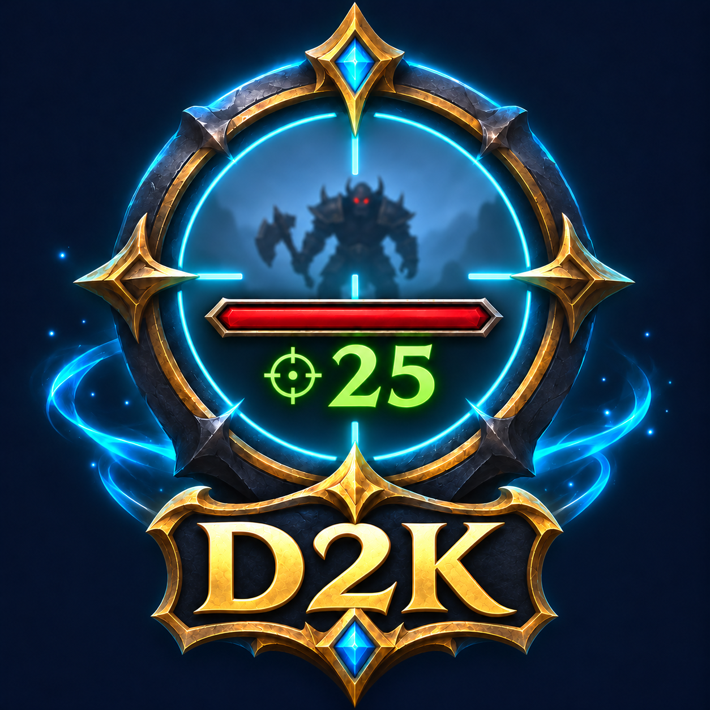

# D2K

[](https://github.com/CraightonH/D2K/actions/workflows/checks.yml)
[](LICENSE)



D2K adds compact distance estimates to friendly and enemy nameplates in **WoW Forever**. Enemy indicators change color based on your hovered spell, current cast, or last successful cast, helping you develop a feel for spell range.

- A small number beneath the health bar: `25` means **within 25 yards**.
- Spell priority: **hovered spell → current cast/channel → last successful cast**.
- Friendly distances use their own checks, including proximity checks outside combat and confirmed group-member distances when available.
- Configurable fonts, colors, opacity, placement, icons, and update interval. Icons scale with text by default.
- Six built-in icon shapes, native raid markers, optional ForeverAuras icon files, and custom texture paths or file IDs.

## Install and configure

Install a packaged ZIP from [Releases](https://github.com/CraightonH/D2K/releases) or the [CurseForge project](https://www.curseforge.com/projects/1831997). The archive contains one `D2K` folder; place it in `World of Warcraft/_forever_/Interface/AddOns/` and enable **D2K** in the AddOns list.

Enable enemy nameplates with **V** and friendly nameplates with **Shift+V**, or your configured bindings. Open **`/d2k`** or **Options → AddOns → D2K** for settings. The icon chooser is under **Range icon…**.

| Command | Purpose |
| --- | --- |
| `/d2k` | Open settings |
| `/d2k on` / `/d2k off` | Enable or hide overlays |
| `/d2k clear` | Forget the last successful spell |
| `/d2k reset` | Reset settings |
| `/d2k debug` | Print client and available target range checks |

## Precision

Numbers round the confirmed upper limit **up** to the next five yards. Displaying multiples of five does not guarantee five-yard measurement precision: friendly checks can have wider gaps than enemy checks. `?` means the client supplied no usable upper limit.

Range checks do not guarantee line of sight, facing, cooldown readiness, resources, or a successful cast. Hidden, restricted, invalid, and contradictory answers remain unknown. D2K does not draw terrain or world range overlays.

Optional ForeverAuras icons reference that addon's existing files; no ForeverAuras code or textures are bundled. Built-in icons work independently.

## Development

This repository was generated from [wow-addon-template](https://github.com/CraightonH/wow-addon-template) and uses its shared workflows pinned to **`workflows-v1.0.1`**.

Install Lua 5.1 and Python 3, then run:

```sh
python3 scripts/check.py
```

Checks validate TOC/package metadata, Lua syntax, the 124-assertion mocked client suite, and the upstream-watcher tests. Simulated tests do not replace [in-game verification](docs/client-testing.md).

The source TOC uses `@project-version@`; the pinned BigWigs packager assigns the actual version when building. Install a packaged ZIP rather than the raw source checkout. CI produces a validated candidate ZIP for branch pushes and pull requests.

See [release setup](docs/releasing.md), [shared workflow configuration](docs/reusable-workflows.md), [data and media provenance](docs/provenance.md), and the packaged [README](README.txt) for further details.

## License

[MIT](LICENSE). Copyright © 2026 Craighton.
